<!-- Banner: light/dark variants live in assets/ -->
<picture>
  <source media="(prefers-color-scheme: dark)" srcset="assets/banner-dark.svg">
  <source media="(prefers-color-scheme: light)" srcset="assets/banner-light.svg">
  
</picture>

  <picture>
    <source media="(prefers-color-scheme: dark)" srcset="https://readme-typing-svg.demolab.com?font=Fira+Code&weight=500&size=20&duration=3000&pause=1000&color=07D2BE&center=true&vCenter=true&width=640&lines=Senior+Software+Engineer+%C2%B7+4%2B+years;Backend%3A+Java+%C2%B7+Spring+Boot+%C2%B7+C%23+%C2%B7+.NET;Frontend%3A+Angular+%C2%B7+React+%C2%B7+TypeScript;REST+APIs+%C2%B7+PostgreSQL+%C2%B7+Oracle+%C2%B7+MySQL;Docker+%C2%B7+Kubernetes+%C2%B7+AWS+%C2%B7+Linux;Logistics+SaaS+%C2%B7+60M%2B+orders+across+3+countries">
    
  </picture>

  
  
  
  

## 👋 About me

Senior Software Engineer with **4+ years** of experience building scalable, high-performance web platforms. My focus is the **backend**: designing RESTful APIs and data models with **Java / Spring Boot** and **C# / .NET** on PostgreSQL, Oracle and MySQL, backed by full-stack depth in Angular and TypeScript. I've built logistics and order-management SaaS platforms, including a system that has delivered **60M+ orders across Egypt, KSA and Kuwait**.

- 💼 **Now:** Full-Stack Developer at **NTG Clarity**, building Spring Boot REST APIs for Angular apps on PostgreSQL and Oracle
- ⚙️ **Focus:** backend engineering with Java/Spring Boot and C#/.NET, API design and SQL performance
- 🐳 **DevOps & cloud:** Docker, Kubernetes, AWS and Linux
- 🤖 **AI-assisted:** Claude Code and OpenAI Codex in daily work to ship faster without lowering code quality
- 👨‍🏫 **Mentor:** former ITI instructor for web and UI development
- 📫 **Reach me:** [mohamdyahia@outlook.com](mailto:mohamdyahia@outlook.com)

## 🛠️ Tech stack

### ⚙️ Backend (primary focus)

<table>
  <tr>
    <th width="50%">☕ Java · Spring Boot</th>
    <th width="50%">🟣 C# · .NET</th>
  </tr>
  <tr>
    <td align="center">
      <picture>
        <source media="(prefers-color-scheme: dark)" srcset="https://skillicons.dev/icons?i=java,spring,hibernate,maven,gradle,idea&theme=dark">
        
      </picture>
    </td>
    <td align="center">
      <picture>
        <source media="(prefers-color-scheme: dark)" srcset="https://skillicons.dev/icons?i=cs,dotnet,visualstudio,rider&theme=dark">
        
      </picture>
    </td>
  </tr>
  <tr>
    <td valign="top">

`Java 17+` `Spring Boot` `Spring MVC · REST` `Spring Data JPA` `Hibernate` `Spring Security · JWT · OAuth2` `Spring Cloud · Microservices` `Maven` `Gradle` `JUnit 5` `Mockito`

</td>
    <td valign="top">

`C#` `.NET 8+` `ASP.NET Core Web API` `Entity Framework Core` `LINQ` `ASP.NET Core Identity · JWT` `Clean Architecture` `CQRS · MediatR` `SignalR` `xUnit` `Moq`

</td>
  </tr>
</table>

**Shared backend & data**

  <picture>
    <source media="(prefers-color-scheme: dark)" srcset="https://skillicons.dev/icons?i=postgres,mysql,redis,kafka,rabbitmq&theme=dark">
    
  </picture>

`RESTful APIs` `Microservices` `OOP · SOLID` `Design patterns` `SQL & query optimization` `PostgreSQL` `Oracle Database` `MySQL` `SQL Server` `Redis` `Kafka` `RabbitMQ` `OpenAPI · Swagger` `Unit & integration testing`

### 🐳 DevOps & cloud

  <picture>
    <source media="(prefers-color-scheme: dark)" srcset="https://skillicons.dev/icons?i=docker,kubernetes,aws,linux,githubactions,jenkins,nginx,git&theme=dark">
    
  </picture>

`Docker` `Kubernetes` `AWS` `Linux` `CI/CD` `GitHub Actions` `Jenkins` `Nginx` `Git`

### 🎨 Frontend

  <picture>
    <source media="(prefers-color-scheme: dark)" srcset="https://skillicons.dev/icons?i=angular,ts,js,react,nextjs,redux,materialui,tailwind,bootstrap,sass&theme=dark">
    
  </picture>

`Angular` `RxJS` `Angular Material` `TypeScript` `React` `Next.js` `React Native` `Redux` `MUI` `Tailwind CSS` `Webpack` `Service Workers`

### 🤖 AI tools & ways of working

`Claude Code` `OpenAI Codex` `ChatGPT` `GLM` `Google Antigravity` `Prompt engineering` `Agile` `Scrum` `Code reviews` `Mentoring`

## 💼 Experience

**Full-Stack Developer** · NTG Clarity · Cairo · _Apr 2025 – Present_
- Build full-stack features with **Java/Spring Boot** REST APIs and Angular/TypeScript frontends.
- Design data models and write optimized SQL on **PostgreSQL** and **Oracle Database**.

**Senior Software Engineer** (promoted from Software Engineer II) · Advansys · Cairo (hybrid) · _Aug 2023 – Apr 2025_
- Built core modules of the company's logistics platform: shipment tracking, order dispatching and fleet management.
- Designed and integrated RESTful APIs with **C# and .NET**, with optimized SQL on **MySQL**.
- Built data-heavy Angular/RxJS dashboards with advanced filtering, real-time status updates and operational reports.
- Led features end to end, mentored junior engineers and drove code reviews and technical decisions in an Agile team.

**Frontend Developer** · Roboost · Cairo · _Aug 2022 – Aug 2023_
- Spearheaded an automated order-management SaaS dashboard; the system now delivers **60M+ orders across Egypt, KSA and Kuwait**.
- Refactored and optimized the Angular codebase, cutting bundle sizes for faster load times and a more responsive UI.

**External Instructor** · Information Technology Institute (ITI) · Remote · _Jun 2023 – 2025_
- Designed and taught web and UI development curricula (HTML, CSS, JavaScript, Angular, React) and mentored students into job-ready developers.

## 🚀 Projects

**🧪 Physics Experiments Simulation** · [Live](https://physics-experiments-simulation-ebon.vercel.app/weight) · [Code](https://github.com/0xYahia/physics-experiments-simulation) 
Saudi educational platform where students run physics experiments through interactive drag-and-drop simulations. 
`Next.js` `Tailwind CSS` `dnd kit`

**🛋️ Furnival: e-commerce platform (team project)** · [Live](https://user-nu.vercel.app/) · [Code](https://github.com/Graduation-Proj-ITI) 
Responsive furniture e-commerce platform optimized for all devices and browsers, with secure payment gateways and user authentication integrated with the backend team.

## 📊 GitHub activity

<!-- These images are regenerated daily by .github/workflows/profile-assets.yml and published to the `output` branch. -->

  <picture>
    <source media="(prefers-color-scheme: dark)" srcset="https://raw.githubusercontent.com/0xYahia/0xYahia/output/stats-dark.svg">
    
  </picture>
  <picture>
    <source media="(prefers-color-scheme: dark)" srcset="https://raw.githubusercontent.com/0xYahia/0xYahia/output/streak-dark.svg">
    
  </picture>

  <picture>
    <source media="(prefers-color-scheme: dark)" srcset="https://raw.githubusercontent.com/0xYahia/0xYahia/output/snake-dark.svg">
    
  </picture>

<i>Open to backend engineering opportunities (Java/Spring Boot, C#/.NET) and collaborations. Email or LinkedIn is the fastest way to reach me.</i>

