<!-- Banner: light/dark variants live in assets/ -->
<picture>
  <source media="(prefers-color-scheme: dark)" srcset="assets/banner-dark.svg">
  <source media="(prefers-color-scheme: light)" srcset="assets/banner-light.svg">
  
</picture>

  <picture>
    <source media="(prefers-color-scheme: dark)" srcset="https://readme-typing-svg.demolab.com?font=Fira+Code&weight=500&size=20&duration=3000&pause=1000&color=07D2BE&center=true&vCenter=true&width=640&lines=Full-Stack+Software+Engineer+%40+Advansys+ESC;Angular+%C2%B7+React+%C2%B7+Next.js+on+the+front+end;Node.js+%C2%B7+NestJS+%C2%B7+PostgreSQL+on+the+back+end;Arabic+%2F+English+(RTL)+web+apps;Open+to+new+opportunities">
    
  </picture>

  
  
  
  

## 👋 About me

I'm a full-stack software engineer in Cairo, Egypt, currently at **Advansys ESC**. I build web products end to end, mostly in TypeScript: Angular and React/Next.js on the front end, Node.js and NestJS APIs on the back end. I came to software from a commerce degree and trained through ITI's 9-month Web & UI Development program.

- 💼 **Now:** Software Engineer at Advansys ESC
- 🌍 **Shipping:** bilingual Arabic/English (RTL) web apps with Next.js and next-intl
- 🌱 **Leveling up:** NestJS architecture, Node.js internals and Nx monorepos
- 💬 **Ask me about:** Angular, React/Next.js, NestJS, REST API design
- 📫 **Reach me:** [mohamdyahia@outlook.com](mailto:mohamdyahia@outlook.com)

## 🛠️ Tech stack

  <b>Languages</b> 
  <picture>
    <source media="(prefers-color-scheme: dark)" srcset="https://skillicons.dev/icons?i=ts,js,html,css,sass,c,cpp&theme=dark">
    
  </picture>

  <b>Frontend</b> 
  <picture>
    <source media="(prefers-color-scheme: dark)" srcset="https://skillicons.dev/icons?i=angular,react,nextjs,redux,tailwind,bootstrap,vue&theme=dark">
    
  </picture>

  <b>Backend &amp; data</b> 
  <picture>
    <source media="(prefers-color-scheme: dark)" srcset="https://skillicons.dev/icons?i=nodejs,nestjs,express,postgres,mongodb,redis&theme=dark">
    
  </picture>

  <b>Cloud &amp; tools</b> 
  <picture>
    <source media="(prefers-color-scheme: dark)" srcset="https://skillicons.dev/icons?i=docker,aws,git,github,githubactions,vercel,postman,figma,vscode&theme=dark">
    
  </picture>

## 🚀 Featured projects

**🧽 Medi Clean: bilingual booking website** · [Live](https://0xyahia.github.io/cleaning-platform/) · [Code](https://github.com/0xYahia/cleaning-platform) 
Arabic/English (RTL) website for a home-cleaning company in Saudi Arabia: service pages, booking flow, subscription and loyalty offers, SEO metadata, sitemap and robots, statically exported to GitHub Pages. 
`Next.js 16` `React 19` `TypeScript` `Tailwind CSS 4` `next-intl`

**🧪 Physics Lab: interactive experiments** · [Live](https://physics-experiments-simulation.vercel.app) · [Code](https://github.com/0xYahia/physics-experiments-simulation) 
Arabic drag-and-drop physics experiments: apply a push force and watch acceleration and speed plotted live, or compare an object's weight on Earth, the Moon and Mars. 
`Next.js` `React` `TypeScript` `dnd-kit` `Highcharts` `Tailwind CSS`

**🛒 Dawiny: e-commerce REST API** · [Code](https://github.com/0xYahia/E-Commerce-Using-Node.js) 
JWT authentication and authorization, product CRUD, shopping cart and orders, Stripe payments, image uploads with Multer and Sharp, filtering and pagination. 
`Node.js` `Express` `MongoDB` `Mongoose` `Stripe` `JWT`

**🧠 Data structures & algorithms** · [Data Structures](https://github.com/0xYahia/Data-Structures) · [Algorithms](https://github.com/0xYahia/Algorithm) · [LeetCode](https://github.com/0xYahia/Problem-solving-LeetCode) 
Core data structures, algorithms and problem-solving practice in TypeScript.

## 💼 Experience

**Software Engineer · Advansys ESC** · _Present_ 
Building and maintaining web applications end to end. Full history on [LinkedIn](https://www.linkedin.com/in/0xyahia/).

## 🎓 Education

- **Information Technology Institute (ITI)**: 9-Month Professional Diploma, Web & UI Development · 2022 – 2023
- **Al-Azhar University**: Bachelor of Commerce · 2016 – 2020

## 📊 GitHub activity

<!-- These images are regenerated daily by .github/workflows/profile-assets.yml and published to the `output` branch. -->

  <picture>
    <source media="(prefers-color-scheme: dark)" srcset="https://raw.githubusercontent.com/0xYahia/0xYahia/output/stats-dark.svg">
    
  </picture>
  <picture>
    <source media="(prefers-color-scheme: dark)" srcset="https://raw.githubusercontent.com/0xYahia/0xYahia/output/top-langs-dark.svg">
    
  </picture>

  <picture>
    <source media="(prefers-color-scheme: dark)" srcset="https://raw.githubusercontent.com/0xYahia/0xYahia/output/streak-dark.svg">
    
  </picture>

  <picture>
    <source media="(prefers-color-scheme: dark)" srcset="https://raw.githubusercontent.com/0xYahia/0xYahia/output/snake-dark.svg">
    
  </picture>

<i>Open to new opportunities and collaborations. Email or LinkedIn is the fastest way to reach me.</i>

